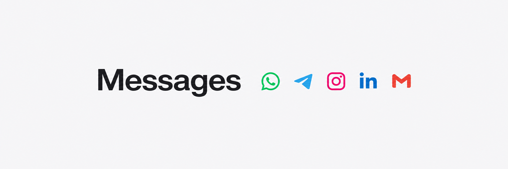

# Messages

A small native messaging workspace for Linux. Built with Rust, GTK and WebKitGTK.

<picture>
  <source media="(prefers-color-scheme: dark)" srcset="docs/images/banner-dark.png">
  <source media="(prefers-color-scheme: light)" srcset="docs/images/banner-light.png">
  
</picture>

WhatsApp · Telegram · Instagram · LinkedIn · Gmail

- **Native shell.** GTK window, menus and dialogs. Embedded WebKitGTK pages.
- **Adaptive interface.** A dark logo sidebar becomes a bottom bar in small windows.
- **Fast switching.** Loaded pages stay ready; safe inactive pages sleep after ten minutes.
- **Exit means exit.** Closing the window shuts down the app and its engine workers.

## Run

[Download v0.3.2](https://github.com/Wezzeso/Chat-maxxing/releases/tag/v0.3.2)
for the Debian/Ubuntu installer or portable Linux package.

The prebuilt app targets Linux x86-64. Requires GTK 3.24+, WebKitGTK 4.1
(WebKit 2.42+) and glibc 2.34+.

From the portable package:

```sh
./run.sh
./run.sh --doctor
```

Or install the Debian/Ubuntu package:

```sh
sudo apt install ./relay-native_0.3.2_amd64.deb
relay-native
```

Click a service to open its web app. Right-click its logo for **Keep awake** or
**Sleep**. Sleeping pauses live updates; the moon sleeps eligible pages.

## Build

Requires Rust 1.88+ and the runtime libraries above.

```sh
cargo run --release --locked
```

The release executable is written to `target/release/relay`.

## Verify

```sh
cargo fmt --check
cargo clippy --locked --all-targets -- -D warnings
cargo test --locked
```

For the native GUI check, see [verification](docs/VERIFICATION.md).
Observed empty startup: **44 MB PSS** before opening services.
Loaded pages and engine workers add memory.

## Compatibility

The five services open their own web apps. Account sign-in and messaging remain
unverified; providers may reject embedded browsers, especially Google account
flows. This app uses WebKitGTK; Gecko is not included.

Cookies and website data stay in `~/.local/share/relay-native`; cache stays in
`~/.cache/relay-native`. XDG overrides are respected. A separate profile is used
for the native app.

[Architecture](docs/ENGINE.md) · [Verification](docs/VERIFICATION.md) ·
[Icon credits](docs/ICONS.md) · [MIT license](LICENSE)
